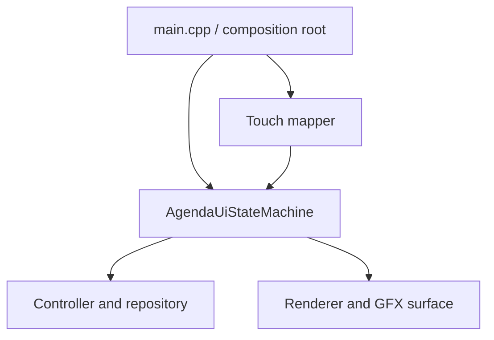

# ESP32 Full Agenda Integration Design

**Date:** 2026-09-10  
**Status:** Approved design  
**Target:** Waveshare ESP32-S3-Touch-LCD-1.28, Arduino framework, PlatformIO

## 1. Purpose

This milestone connects the already tested agenda core and UI to the physical
Waveshare ESP32-S3-Touch-LCD-1.28. The finished firmware provides the complete
offline agenda flow on the 240x240 round touch display: clock setup, monthly
calendar navigation, daily event lists, event details, creation, editing,
deletion, Greek/English/numeric T9 text entry, Flash persistence, and visual
reminders.

The existing platform-independent core remains the source of truth. Arduino,
Arduino_GFX, touch hardware, and LittleFS are introduced only through narrow
platform adapters.

## 2. Approved Product Behaviour

- Operation is fully offline after flashing; Wi-Fi is not required.
- The calendar uses a classic month grid with Monday as the first weekday.
- The user navigates with visible arrow controls; swipe gestures are excluded.
- Selecting a calendar cell selects that cell's date, including the intended
  date change when navigating to another month.
- A day can contain all-day events and events with a specific time.
- Event text supports Greek, English, and numbers through T9.
- T9 retains its existing 900 ms character-cycling interval, language, case,
  mode switching, UTF-8-safe editing, and 500-code-point limit.
- Events can be viewed, created, edited, and deleted.
- Saving returns the user to the established agenda flow rather than producing
  an unrelated confirmation screen.
- Events remain stored after notification and after device restart.
- A timed event becomes due one day before at the same time.
- An all-day event becomes due at 17:00 on the previous day.
- Acknowledging a reminder is persisted so the same occurrence is not shown
  repeatedly.
- The first integration milestone does not add sleep or power-management
  behaviour. Those concerns are deferred until the complete functional flow is
  verified on hardware.

## 3. Architectural Approach

The approved approach is a set of thin ESP32 adapters around the existing core
and renderer. Direct Arduino calls will not be added to core or UI logic, and
the renderer will not be replaced by LVGL.

The direction of dependencies remains inward: hardware adapters depend on
platform-neutral interfaces, while the core has no knowledge of Arduino,
LittleFS, or the display library.

## 4. Components

### 4.1 ArduinoGfxSurface

`ArduinoGfxSurface` implements `DrawSurface` using the `Arduino_GFX` instance
owned by `DisplayHardware`.

Responsibilities:

- Convert `UiColor` RGB888 values to RGB565.
- Implement clearing, rectangles, rounded rectangles, circles, and lines.
- Map each `UiTextStyle` to an embedded font and size.
- Calculate text width before drawing so left, centre, and right alignment match
  the `DrawSurface` contract.
- Respect the exact length of every `std::string_view`; text must not be treated
  as an implicitly null-terminated buffer.
- Enable UTF-8 output with `setUTF8Print(true)`.
- Use U8g2's Greek-capable Unifont subset, including
  `u8g2_font_unifont_t_greek`, so the same UTF-8 strings used by the desktop
  tests reach the display unchanged.

`AgendaRenderer` remains platform-independent and is not rewritten.

### 4.2 AgendaTouchMapper

`AgendaTouchMapper` is a platform-independent UI component. It receives the
current `AgendaUiView`, a valid release point, and the action timestamp. It
returns either one `AgendaUiAction` or no action.

Responsibilities:

- Give an active overlay priority over the screen underneath it.
- Map the 42 month cells to `SelectDate` with the cell's actual date.
- Map month and day pagination arrows.
- Map event rows and footer actions.
- Map clock-setup and editor increment/decrement controls.
- Map all T9 digits and language, mode, case, backspace, save, and cancel
  controls.
- Populate `timestampMilliseconds` for T9 actions.
- Return no action for disabled controls, empty event rows, empty calendar
  cells, gaps between controls, or points outside the display.

The mapper performs no state mutation. Only `AgendaUiStateMachine::handle()`
changes application state.

### 4.3 Touch Sampling Policy

`TouchHardware` continues to expose hardware samples. The ESP32 loop tracks the
press lifecycle and sends one point to `AgendaTouchMapper` only on release.

- Holding a finger down does not repeat an action.
- Samples outside 240x240 are ignored.
- A press whose position moves more than 12 pixels from its initial point is
  cancelled instead of being interpreted as a button activation.
- No blocking wait is used for a complete gesture; the main loop continues to
  service clock and reminder ticks.

### 4.4 Esp32Clock

`Esp32Clock` implements the existing `Clock` interface.

- At every cold boot or software restart, the clock begins invalid.
- The state machine displays `ClockSetup` until the user confirms a valid date
  and time.
- Confirmation records a base `DateTime` and the current monotonic ESP32 timer.
- `now()` adds monotonic elapsed time to that base through the existing
  date/time arithmetic.
- The elapsed-time source uses a 64-bit monotonic value so normal operation is
  not affected by the 32-bit `millis()` wrap interval.
- Stored event data is loaded before clock confirmation, but reminder
  evaluation waits until the clock is valid.
- Immediately after confirmation, the state machine checks for a due reminder
  before displaying the normal month view.

Flash does not pretend to preserve correct wall-clock time while the device is
unpowered. The clock value therefore is not restored as authoritative time.
Because the core depends only on `Clock`, a future external RTC can replace
`Esp32Clock` without changing agenda logic.

### 4.5 LittleFsByteStorage

`LittleFsByteStorage` implements the existing `ByteStorage` contract on the
internal 16 MB Flash.

- LittleFS is mounted once during startup.
- The existing event codec, version header, CRC validation, main/temp/backup
  recovery strategy, and `nextId` rules remain unchanged.
- Successful writes are flushed and closed before being reported as complete.
- Mount, open, read, resize, flush, and write failures are returned through the
  existing storage and controller error paths.
- LittleFS is never automatically formatted after a mount failure, because
  automatic formatting could destroy recoverable agenda data.
- The current `default_16MB.csv` partition configuration is retained and
  PlatformIO is configured to use LittleFS for its filesystem partition.

Maximum capacity remains 500 events. Deleting an event does not reuse its ID.

## 5. Startup and Runtime Flow

Startup proceeds in this order:

1. Start Serial diagnostics.
2. Initialise the display while the backlight remains off.
3. Initialise the touch controller.
4. Mount LittleFS and construct the storage/repository/controller chain.
5. Load and validate agenda data, using the existing backup recovery rules.
6. Start `AgendaUiStateMachine` with an invalid `Esp32Clock`.
7. Render `ClockSetup` and enable the backlight.
8. After clock confirmation, evaluate reminders and render either the reminder
   overlay or the current month.

The runtime loop is non-blocking:

1. Read one touch sample.
2. Update press/release tracking.
3. On a valid release, map at most one action and pass it to the state machine.
4. Tick the state machine once per second to detect reminder transitions.
5. Render after startup and whenever an action, reminder, or error changes the
   visible view.

The full display is not redrawn continuously when nothing has changed. This
reduces flicker and unnecessary SPI traffic. Every mapped action triggers one
render. For the once-per-second tick, the loop compares the overlay, reminder
event ID, and error fields before and after the tick and renders only when one
of them changes.

## 6. Error Handling

- **Display initialisation failure:** keep the backlight off, emit a stable
  Serial error marker, and stop application startup.
- **Touch initialisation failure:** show a visible failure message when the
  display works, emit a Serial marker, and do not enter an unusable agenda UI.
- **LittleFS mount or repository startup failure:** enter `StartupError` and
  allow the existing retry action; do not format Flash.
- **Invalid primary data with valid backup:** continue with recovered data and
  emit a Serial recovery marker.
- **Create, update, delete, or reminder-acknowledgement write failure:** retain
  the last committed state, show the existing operation error overlay, and use
  the existing retry/cancel actions.
- **Invalid clock setup:** remain on `ClockSetup` and expose the existing clock
  error state.
- **Out-of-range or malformed touch sample:** ignore the sample without
  changing application state.

## 7. File Changes

New files:

- `src/ui/agenda_touch_mapper.h`
- `src/ui/agenda_touch_mapper.cpp`
- `tests/test_agenda_touch_mapper.cpp`
- `src/platform/esp32/arduino_gfx_surface.h`
- `src/platform/esp32/arduino_gfx_surface.cpp`
- `src/platform/esp32/esp32_clock.h`
- `src/platform/esp32/esp32_clock.cpp`
- `src/platform/esp32/littlefs_byte_storage.h`
- `src/platform/esp32/littlefs_byte_storage.cpp`

Modified files:

- `platformio.ini`: compile the required root, core, UI, and ESP32 sources; add
  U8g2; select LittleFS.
- `src/platform/esp32/main.cpp`: replace the touch smoke test with the
  composition root and non-blocking application loop.

No core interface change is planned for this milestone, and no Arduino-specific
type may appear in `src/core` or `src/ui`. If implementation reveals that a
core-interface change is unavoidable, implementation stops and that change is
designed and approved separately.

## 8. Test Strategy

### 8.1 Desktop Tests

All existing tests must continue to pass. New mapper tests cover:

- every screen's active controls;
- all overlay priorities and actions;
- 42 calendar-cell hit areas and actual dates;
- enabled and disabled pagination controls;
- event-row selection;
- editor controls;
- all T9 keys and timestamps;
- gaps, boundaries, empty cells, and out-of-range points;
- exactly one action for one completed touch.

RGB565 conversion and alignment calculations are kept independent from Arduino
calls and covered by desktop tests. The existing date/time arithmetic tests
cover the elapsed-time calculations used by `Esp32Clock`; the hardware adapter
itself is verified by the ESP32 build and device checks.

### 8.2 ESP32 Build Verification

`pio run -e waveshare_esp32_s3_touch_lcd_1_28` must complete successfully with
all required core, UI, filesystem, display, and font sources linked.

### 8.3 Device Verification

The physical-device checklist covers:

1. Display and touch initialisation.
2. Correct Greek, English, numeric, and accented Greek rendering.
3. Clock setup and progression across minute/day boundaries.
4. Previous/next month navigation and date selection.
5. Day-list pagination and event selection.
6. Creation of timed and all-day events with Greek T9 input.
7. T9 language, mode, case, cycling, and backspace behaviour.
8. Event review, save, edit, delete, and discard confirmation.
9. Persistence after restart and restoration of the exact next event ID.
10. Timed and all-day reminder display after clock confirmation.
11. Persistent reminder acknowledgement.
12. Recovery from a deliberately corrupted primary record when the backup is
    valid, using a controlled test image rather than production user data.
13. No duplicate actions from a held touch.

## 9. Implementation Order

1. Add failing desktop tests for `AgendaTouchMapper`, then implement it.
2. Add `ArduinoGfxSurface`; build and run a device smoke screen containing
   Greek, English, and numbers.
3. Add `Esp32Clock`; verify `ClockSetup` and elapsed time.
4. Add `LittleFsByteStorage`; verify write, restart, load, and backup recovery.
5. Replace the ESP32 touch-test `main.cpp` with the complete composition root.
6. Run the entire desktop suite and PlatformIO build.
7. Execute the physical-device acceptance checklist.

Each stage is completed and verified before the next stage begins.

## 10. Acceptance Criteria

The milestone is complete when:

- the complete agenda UI is usable only through the physical round touch
  display;
- Greek/English/numeric T9 input and UTF-8 rendering work correctly;
- timed and all-day events can be created, viewed, edited, and deleted;
- saved events and reminder acknowledgements survive restart;
- clock setup is required after restart and reminder evaluation resumes
  immediately after confirmation;
- storage failures do not silently erase or replace valid data;
- all desktop tests and the PlatformIO build pass; and
- the device requires neither a connected computer nor Internet during normal
  use.
